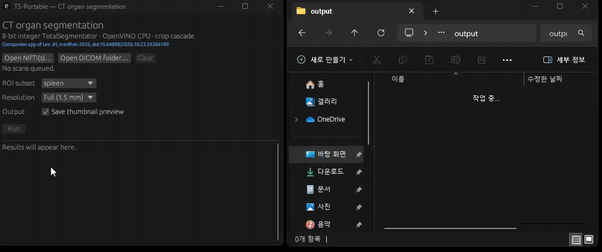

# ts-portable

Segment organs on a CT scan on an ordinary computer, in seconds. No GPU, no Python, no setup.

ts-portable is an 8-bit integer build of
[TotalSegmentator](https://github.com/wasserth/TotalSegmentator) that runs on the CPU. It
accompanies the manuscript *Quantized TotalSegmentator for Fast Abdominal Organ Segmentation on
CPUs*, where it is called **TS-Portable**.

| Abdominopelvic CT, all structures | ts-portable, CPU | TotalSegmentator, CPU | TotalSegmentator, GPU |
|---|---|---|---|
| 1.5 mm | **48 s** | 343 s | 62 s |
| 3 mm | **3.9 s** | 27 s | 16 s |

Median time per scan over 100 abdominopelvic CT scans, including model loading. CPU: AMD Ryzen
Threadripper PRO 7945WX (12 cores); GPU: NVIDIA RTX A6000. On a six-core office PC (Intel Core
i5-10400), segmenting the spleen alone took a median of 5.8 s. Accuracy was noninferior to the
reference implementation (mean Dice difference 0.00017).



*The Windows app segmenting the spleen on the CPU, in real time.*

## Try it (Windows)

1. Download **[the app](https://github.com/sigjhl/ts-portable/releases/latest/download/ts-portable-windows.zip)**
   (about 220 MB, models included), right-click it, choose **Extract All…** and extract it anywhere
   (the Desktop is fine). Open the extracted folders until you see `ts-portable.exe`:

   ```
   ts-portable-windows\
   ├── ts-portable.exe                       ← the app: double-click this
   ├── ts-portable-cli.exe
   ├── onnxruntime\
   ├── licenses\
   └── models\
       ├── total_1p5mm_291_organs_int8.onnx
       ├── ...                               (seven .onnx files in all)
       └── total_label_map.json
   ```

2. Double-click **`ts-portable.exe`**. If Windows warns about an unrecognized app, click
   **More info → Run anyway** (the app is not code-signed).
3. Open a NIfTI file or a DICOM folder, pick the organs, click **Run**.

Each scan gets an `output/<scan name>/` folder next to the app with the organ masks, an optional
`preview_total.png`, and a table of volume (mL) and mean and median HU.

On macOS or Linux, [build from source](docs/BUILD.md).

## Command line

```
ts-portable-cli -i scan.nii.gz -o output/ --device openvino --int8 --roi_subset spleen,liver --statistics -
```

| Option | Does |
|---|---|
| `--roi_subset a,b` | segment only these organs (faster) |
| `--fast` | 3 mm models instead of 1.5 mm |
| `--statistics` | write volumes and HU to `statistics.json` next to the masks; `--statistics -` prints them to the terminal instead |
| `--preview` | write a PNG overlay next to the masks |

The input can be a NIfTI file or a DICOM folder. `ts-portable-cli --help` lists everything;
[docs/BUILD.md](docs/BUILD.md) covers DICOM series selection, where the models and ONNX Runtime are
found, and the setting that reproduces the paper.

## fp32 models (Mac, NVIDIA GPU)

The app and the command above use the INT8 models, which need an x86-64 CPU. The unquantized fp32
models are in the [`fp32/` folder of the models repository](https://huggingface.co/sigjhl/ts-portable/tree/main/fp32)
(757 MB) and run on any CPU, including Macs, and on NVIDIA GPUs. Download the folder (for example
`hf download sigjhl/ts-portable --include "fp32/*" --local-dir .`) and pass it instead of `--int8`:

```
ts-portable-cli -i scan.nii.gz -o output/ --models-dir fp32 --device cpu
ts-portable-cli -i scan.nii.gz -o output/ --models-dir fp32 --device cuda
```

`--device cuda` needs the GPU build of ONNX Runtime and NVIDIA's CUDA libraries:
[setup](docs/BUILD.md#nvidia-gpu-cuda).

## More

- **[docs/BUILD.md](docs/BUILD.md)**: building on Windows, Linux and macOS; GPU; verifying the download
- **[Models](https://huggingface.co/sigjhl/ts-portable)**: fp32 and INT8 ONNX models,
  model cards and label maps (checksums in [`deployment/models.sha256`](deployment/models.sha256))
- **[docs/METHOD.md](docs/METHOD.md)**: how the INT8 models were made, and how to rerun it
- **[evaluation/](evaluation/README.md)**: the code and per-case results behind every table and figure
- **[AGENTS.md](AGENTS.md)**: every command, output path and field, for scripts and coding agents

## Citation and license

[`evaluation/`](evaluation/README.md) reproduces the paper's results.

Please cite:

> Lee JH. Quantized TotalSegmentator for Fast Abdominal Organ Segmentation on CPUs. *medRxiv*
> 2026. doi:[10.64898/2026.10.23.26366189](https://doi.org/10.64898/2026.10.23.26366189)

([`CITATION.cff`](CITATION.cff)).

Apache License 2.0 ([`LICENSE`](LICENSE), [`NOTICE`](NOTICE)). Derived from TotalSegmentator
(Wasserthal et al., *Radiology: Artificial Intelligence* 2023) and nnU-Net, both Apache-2.0. The INT8
weights are quantized from the `total` task of TotalSegmentator 2.12.0 and carry the same license.
